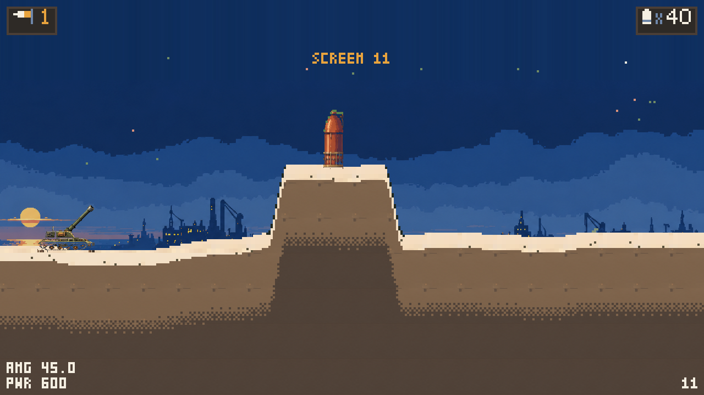
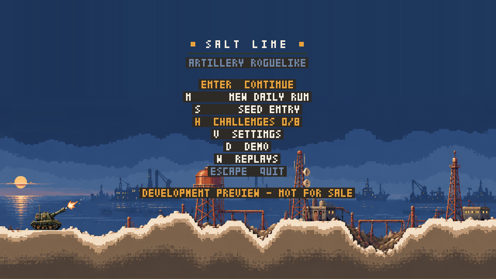
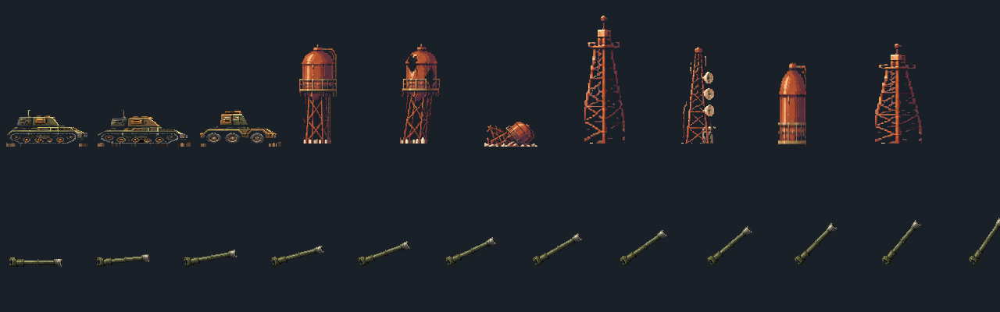

# Salt Line

[](https://github.com/cascadiacollections/saltline/actions/workflows/ci.yml?query=branch%3Amain)
[](https://github.com/cascadiacollections/saltline/releases/latest)
[](https://github.com/cascadiacollections/saltline/releases/tag/dev)
[](LICENSE)

[](rust-toolchain.toml)
[](pyproject.toml)
[](.python-version)
[](project.godot)
[](.zed/tasks.json)
[](docs/development-environment.md)

<!-- These are navigation badges, not live status claims. Public badge services
cannot read this internal repository. Their destinations stay current without
pinning a release version or a CI result in the README. -->

Single-player artillery roguelike. Endless procedural horizon, persistent
terrain damage, shells as the run resource, modifier drafting every four screens.

Deterministic Rust simulation core, Godot 4 presentation layer via `gdext`.

| In play | Title screen |
|---|---|
|  |  |

Actual game captures at 1280×720. Gameplay: seed `20260907`, screen index `10`,
seasonal art off. The title illustration is decorative; playable terrain and
target placement come from the simulation.

- **Play:** daily and seeded runs, a challenge course, local versus with a human
  or AI opponent, a map editor, and saved replays.
- **Build:** Rust owns simulation and solvability checks; Godot handles input,
  audio and presentation. Rendering changes do not change collision geometry.
- **Verify:** tests and cross-platform replay digests run in CI; every generated
  screen is checked against the current loadout before play.

**Status: development preview.** Free, every screen playable. Desktop binaries
are unsigned. [Latest release](https://github.com/cascadiacollections/saltline/releases/latest)
has the published version; the [development build](https://github.com/cascadiacollections/saltline/releases/tag/dev)
follows passing builds of `main`. [RELEASING.md](RELEASING.md) covers supported
platforms, the release checklist, and known issues.

Documentation-only changes (Markdown and README captures) skip the full build
matrix. Markdown embedded in the game or used by golden tests still runs CI;
release tags always run the full checks. README captures alone do not redeploy
the website.

[Build and run](#quick-start) · [Controls](#controls) · [Developer tools](#tools) ·
[Art and assets](#art) · [Determinism](#determinism) · [Report a bug](#reporting-bugs)

## Build prerequisites

Requires Rust `1.99.0` (pinned in `rust-toolchain.toml`), Godot `4.7.2`, and
`uv` 0.13.5 and Python 3.15.0 for the Python asset tools. `just` is optional
but provides the documented shortcuts below.
If you use mise, `mise install` reads the Rust version from the existing
`rust-toolchain.toml`; run commands with `mise exec -- cargo ...`.

The `godot` crate is pinned to the matching `api-4-7` feature. If you raise the
engine version, raise that feature and `compatibility_minimum` in
`salt_line.gdextension` with it: bindings built against a newer API than the
running engine do not load, and the game boots to an empty window instead of
failing loudly.

## Contents

| Path | What it is |
|---|---|
| `design/DESIGN.md` | Full specification — mechanics, terrain, modifiers, art |
| `crates/salt-line-sim` | The whole game. No Godot dependency, no runtime dependencies at all |
| `crates/salt-line-godot` | Rendering, input, UI. Draws what the sim says is true |
| `art/` | Source artwork, detailed game sprites, native fallback, UI palette and app icons |
| `tools/export_sprites.py` | Exports authored Aseprite artwork and embedded textures |
| `tools/gen_sprites.py` | Builds native and detailed previews from exported sprites |
| `site/` | The alpha marketing page, published to GitHub Pages |
| `tools/build_site.py` | Generates every image on that page out of the art pipeline |
| `tools/gen_audio.py` | Deterministically generates the original PCM sound effects |
| `project.godot`, `godot/` | The Godot 4 project. Its root is the repo root, so `res://art/...` is the same path the generator writes |
| `RELEASING.md` | What the preview is, the release checklist, the playtest matrix, known issues |

## Quick start

```sh
cargo test                       # sim + presentation tests, no engine needed
cargo build -p salt-line-godot   # build the GDExtension
godot --path .                   # play
```

`cargo build` before `godot`: the extension is loaded from
`target/{debug,release}/`, so a stale build is what the engine will run.
On Linux, also run `bash tools/build_xdg_portals.sh` once to build the optional
GameMode bridge; see [`docs/xdg-portals.md`](docs/xdg-portals.md). The game still
plays when the desktop portal or GameMode is unavailable.

With `just` installed, the same common operations are available as `just test`,
`just build`, and `just run`. The Python tools use the locked environment from
`pyproject.toml` and `uv.lock`; run `uv sync --locked` once after checkout.

For a repeatable Linux environment, reopen this checkout in the
[devcontainer](docs/development-environment.md). It supports headless Rust
work and Python assets; Godot and mobile SDKs are opt-in.

### Development builds

Every push to `main` that passes CI replaces the
[`dev` prerelease](https://github.com/cascadiacollections/saltline/releases/tag/dev)
with that commit's builds: Linux x86_64 and arm64, macOS (universal), Windows
x86_64 and arm64, and an Android arm64 APK. They are for testing, not
distribution: the desktop builds are unsigned. The APK is signed with the
release key once the owner has set it up (so dev builds and releases install
over each other), and with the debug key until then. Each dev APK gets a
higher versionCode than the last, so it installs as an update; see
RELEASING.md for what that means for going back to a release.

Pushing a `vX.Y.Z` tag builds the same set and publishes it as release
`vX.Y.Z`, with notes from [`CHANGELOG.md`](CHANGELOG.md); see
[RELEASING.md](RELEASING.md) for the version rule, the Android versionCode
scheme and signing.

### Android

`just android` builds the arm64 APK and installs and launches it on the
attached device or emulator (set `ANDROID_SERIAL` if there is more than one);
`just android-log` follows its log. It needs rustup, the Android SDK and NDK
(`ANDROID_HOME`, `ANDROID_NDK_HOME`, defaulting to `~/Android/Sdk` and its
newest NDK), Godot's export templates, and a debug keystore in the Godot editor
settings. Phones use the Compatibility renderer; the desktop keeps Forward+.

A local build has versionCode 1, lower than any CI build, so `just android`
installs with `adb install -r -d` (a debug APK may downgrade). It only
installs over a CI build signed with the same key: over a release-signed dev
build or release it fails with `INSTALL_FAILED_UPDATE_INCOMPATIBLE`, and the
fix is `adb uninstall com.cascadiacollections.saltline`, which deletes the
saves on that device.

`just android-profile` builds an optimized profiling APK (`--features
profiling`) and launches it beside the normal app as
`com.cascadiacollections.saltline.profile`. It auto-plays a fixed-seed run and,
about 34 seconds in, logs CPU timings for the frame upload with the texture
updated and frozen in turn; `just android-profile-log` follows them. Keep the
screen awake: an asleep device never renders. `just android-profile-run
[apk] [--gpu-check]` runs a capture to the end and prints the summary instead:
it reads the log in a way a flood of other apps' messages cannot outrun, waits
for the GPU check's verdict on each scene, warns when a lock screen or
notification shade took focus mid-run (the game pauses, spoiling the timings)
and fails on a GPU check failure.

The profiling APK takes developer flags only from a file, because Godot drops
launch arguments sent to its launcher activity. Write them, whitespace
separated, to `salt-profile-args.txt` in the app's external files directory:

```sh
adb shell 'mkdir -p /sdcard/Android/data/com.cascadiacollections.saltline.profile/files &&
  echo --salt-free > /sdcard/Android/data/com.cascadiacollections.saltline.profile/files/salt-profile-args.txt'
```

`--salt-free` skips the forced fixed-seed autopilot run, so the build starts at
the title like the shipping game: menus can be profiled or stress-tested
(`adb shell monkey -p com.cascadiacollections.saltline.profile ...`) without
touching the real game's saves. Delete the file to get the default run back. It is signed with a throwaway
key generated under `build/`; delete `build/` and the next install needs
`adb uninstall com.cascadiacollections.saltline.profile` first.

`just android-digest` runs the determinism check (see Determinism) on the
attached device as an arm64-v8a binary, the ABI the APK ships, and fails
unless the phone's digest matches this machine's. It pushes a plain executable
to `/data/local/tmp` and runs it over `adb shell`; nothing is installed. CI
can only run Android on an x86_64 emulator, so run this on a phone after any
change to the toolchain or to the sim's arithmetic.

### iOS

On a Mac, `just ios` builds the extension for arm64, exports an Xcode project
to `build/ios`, signs it, then installs and launches it on the attached iPhone
(set `IOS_DEVICE` to a name or UDID if there is more than one physical iPhone).
The default is a debug build (Rust at opt-level 1); `just ios release` builds the
optimised one (LTO, Godot's release template, Xcode's Release configuration),
which is what to use for performance checks. It is untested on a device so far.
Signing uses
Xcode's automatic provisioning, which also registers the phone with your
account. It needs a paid Apple developer account for installs that last a year.
It also needs:

- Xcode, signed in to that account under Settings > Accounts
- rustup and Godot's export templates
- your Team ID as `application/app_store_team_id` in the iOS preset of
  `export_presets.cfg` (it is public, and in every app you sign), or in the
  `IOS_TEAM` environment variable to override that value locally
- Developer Mode on the iPhone (Settings > Privacy & Security), with the phone
  trusting the Mac

If the command-line signing step fails, `just ios-project` stops after the
export. Open `build/ios/SaltLine.xcodeproj`, pick your team under Signing &
Capabilities and press Run. CI builds the same project unsigned on main and on
pull requests that change Apple packaging, dependencies, or build automation.
Gameplay-only pull requests run Linux and Windows checks; the full macOS and
iOS checks run after merge. Release tags retain full platform determinism and
macOS packaging checks.

## Drone Trial prototype

From the title, press **T / D-pad Right** to enter a 30-second Drone Trial.
Use the existing angle/power controls and fire button. Esc/B pauses; Enter/A resumes;
Esc/B again returns to the title. At round end, Enter/A restarts the same seed.
Scores are currently session-only. Drone Trial uses generated coastal scenery,
shared tank sprites and placeholder drones in the existing gameplay buffer.
The art changes presentation only; simulation geometry is fixed at 320×180.

Headless rendering: `godot --headless --path . -- --salt-trial --salt-seed 42
--salt-shot /tmp/trial.png --salt-shot-at 2`. The simulation replay format is
implemented. Finished trials automatically save the latest recording to
`user://drone_trial.replay`, separately from artillery saves. Verify a recording
with `cargo run -p salt-line-sim --bin trial_replay -- <replay-file>`.
`--salt-auto` also fires automatically in Trial for smoke testing.
Run `cargo run -p salt-line-sim --bin trial_determinism` to exercise 200
persisted replays and produce a cross-platform digest.

## Controls

| Keyboard | Controller | Touch | Action |
|---|---|---|---|
| Left / Right | D-pad or left stick | `<` `>`, or drag | Angle, one quantization step (Shift: ten) |
| Up / Down | D-pad or left stick | `-` `+`, or drag | Power (Shift: ten steps) |
| Space | A | FIRE, or let go of a drag | Fire |
| `[` `]` | LB / RB | `F-` `F+` | Airburst fuse distance (with Airburst) |
| `,` `.` | X / Y | `E<` `E>` | Reposition the emplacement (needs Enfilade) |
| 1 / 2 / 3 | X / A / B | Tap a card | Take a draft offer |
| Enter | A | Tap the row | Daily run, confirm, continue |
| S | — | SEED ENTRY | Seed entry (touch has an on-screen keypad) |
| 2 | LB (on the title) | LOCAL VERSUS | Local versus, two players on one device (see below) |
| D | D-pad down (on the title) | DEMO (top-left corner) | Watch the attract demo (see below) |
| Down | D-pad down (on the pre-match screen) | GROUND row, `<` | Pick the ground for a local versus match: generated, or a map |
| E | X (pre-match, a match's pause or result) | MAKE MAP (pre-match, top-right corner) | Open the map editor (see below); on a match's pause or result, make a map of the round |
| H | D-pad left (on the title) | CHALL | The challenge course; COPY CODE on its result screen exports a layout code |
| W | D-pad up (on the title) | REPLAYS (top-left, under DEMO) | The list of finished runs and matches, to watch again (see below) |
| W | D-pad up (run over, match won) | WATCH | Watch the run or match just finished |
| S | Y (REPLAYS list, a replay's end) | the star beside a row; STAR at a replay's end | Star a replay to keep it for good, or take its star off (see below) |
| D | D-pad down (on Controls) | IDLE DEMO | Start the demo by itself after 30 s on the title (on by default) |
| U | RB (on Controls) | SEASONAL | Cycle automatic, off, Halloween, Thanksgiving and Christmas target art |
| C | X | COPY SEED | Copy the seed (on the run-over screen) |
| R | Y | SAME SEED AGAIN | Replay the same seed |
| V | Back/Select | CONTROLS / AUDIO | Controls and audio screen |
| M | Start | MUTE | Mute/unmute |
| L | X (on Controls) | LAST ARC | Keep the last shot's arc on screen (on by default) |
| F1 | — | — | Debug overlay: template, candidate count, camera, buffer size |
| Esc | B | `II`, or the back gesture | Pause / back |

Touch buttons are drawn in the game's own buffer and font (DESIGN §5.1, §5.6)
and sit along the bottom edge, which is always solid ground. Phones start with
them showing; elsewhere they appear on the first touch. Any key or controller
press switches back, and a tap switches to touch again. Holding a button
repeats like holding a key.

On Windows, mouse clicks use the same touch controls. Choose `AIM: DRAG` in
CONTROLS / AUDIO to click on open ground, pull back and release to fire.

Touch aiming has two modes, chosen with AIM on the CONTROLS / AUDIO screen:

- **Buttons**: the `<` `>` `-` `+` and FIRE buttons.
- **Drag**: put a finger down on open ground and pull back, like a slingshot.
  The direction of the pull sets the angle and its length sets the power, both
  on the same grid as the keys. Let go to fire, or pull back to where you
  started to cancel. ARC chooses the preview shown while you pull. **Short**
  shows only the first stretch of flight, never past the apex or half the
  flight, so never the landing. **Full** shows the
  whole arc without wind. **Full + wind** adds the wind the HUD shows, which is
  none under Dead Reckoning. Short is the default: reading wind stays the
  player's job (DESIGN §2.5).

Until a player picks one, the defaults are `DEFAULT_TOUCH_AIM` and
`DEFAULT_ARC_HINT` in `app.rs`.

Settings, unlocks and scores are stored separately on each device. A new iOS
install therefore starts with `AIM: BUTTONS` even if an Android install was
previously changed to `AIM: DRAG`; choose `AIM: DRAG` on CONTROLS / AUDIO.

LAST ARC, on the same screen for every input, leaves the last shot's path
drawn as a faint dotted line until the next shot or the next screen. It is on
by default (`DEFAULT_LAST_ARC`). It overlaps Chalk Marks and Plumb Line, which
still add more: Chalk keeps up to two landings, and Plumb draws a clear guide at
the apex.

The game automatically changes onboarding labels after the most recent
keyboard, controller or touch input. Stick aiming uses a 0.45 dead zone and the same
delayed repeat as the keyboard, so simulation inputs remain quantized.

Volume, mute, learned onboarding steps, and bindings are stored in the
human-readable `user://salt_line.txt`. The controls screen displays current
bindings and resets them with R/Y. For practical custom remapping, add lines
using `bind ACTION KEY PAD`, for example `bind fire F X`. Supported actions are
`left`, `right`, `up`, `down`, `fire`, `fuse_down`, `fuse_up`,
`reposition_left`, `reposition_right`, `draft_1`, `draft_2`, `draft_3`,
`confirm`, `back`, `copy`, `replay`, `controls`, `mute`, `last_arc`, `seed`,
`new_run`, `versus`, `demo`, `watch` and `star`. The displayed
default token names are accepted; unknown or malformed lines are ignored.

### Local versus

Local versus supports two players on one device or a local AI opponent. On a
touchscreen the title has a LOCAL VERSUS row; with keys it is `2` (pad LB), and
the keyed title does not list it. The pre-match screen sets AIM HELP for each
player (Left / Right, or tap the row), off by default between two players, and
ROLLING GUNS (Up, or tap the row), on by default; START begins. After a match,
REMATCH comes back to this screen with the last choices still set.

Choose RIGHT OPPONENT: AI on the pre-match screen (R / controller Y, or tap
the row) to play the left gun against the computer. HUMAN remains the default.
With the AI on, the left row reads YOUR AIM HELP, ON by default, and the right
gun's aim-help row picks the AI's level instead: AI LEVEL: EASY (the default),
MEDIUM or HARD (Right, or tap the row). Your aim help is remembered for the
session separately against the AI and against a human: switching the opponent
shows that opponent's setting, and resuming a match keeps the help it was
played with as that opponent's. The AI knows the wind and the range and hits about 2, 4
or 6 times in 10, one step less while it leads on hits in the round.
Your handoff plate readies itself after a moment, longer when it calls a
LAST SHOT or a roll (READY skips it); the AI's
plate and aim play themselves. The screens say YOU and AI instead of LEFT GUN
and RIGHT GUN. Pause still stops play. Between rounds TITLE is not offered
against the AI, so a mashed button cannot throw the match away: pause and
TITLE leave it. Every result plate can be paused (Esc / B, or `II` on a
touchscreen), and RESUME comes back to the same plate. On the pause plate,
and on a round's result plate between two players, TITLE asks twice while
the match is still to be won (TAP AGAIN TO QUIT); a second press within 3
seconds quits; RESUME, NEXT ROUND, pausing or waiting cancels it. QUIT on
the title asks twice the same way, and so does Android's back gesture there.
On iOS, where an app is not meant to close itself, it still quits on the
second press. The
opponent and level survive RESUME MATCH and are kept for a rematch. Both
generated ground and custom maps support the AI.

The left gun fires right and the right gun fires left; turns alternate. Each
side has a colour, amber for left and blue for right, used for its gun's tag,
its score pips and its plates. Between turns a plate covers the field: pass the
phone and tap READY (Enter / A). The
same aim controls work for both guns, mirrored for the right one: Left and
Right (and `<` `>`) move either barrel's tip the same way across the screen, and
the right gun's drag pulls back to the right. A hit is any blast that reaches the other gun. First to 3
hits takes a round, but if the player who went first gets the third hit only
one ahead, the other gets one last shot to tie it; a tie plays on. Best of 3 rounds takes the match. After a hit, once both have shot, the
two guns roll a little (together, so it stays fair) and the range has to be
found again; turn ROLLING GUNS off to keep them still. Wind changes every turn,
craters last for the round, and every round is new ground. Aim help shows that
player's last landing mark and arc and a short preview of the current aim.
Esc / B / `II` pauses; TITLE leaves the match. A match in play is kept if the
app is killed (RESUME MATCH on the title), and a run kept for CONTINUE is
left alone.

The pre-match screen's GROUND row picks what the match is played on:
GENERATED (new ground every round, as above), or a map, every round on the
same ground: the four that ship (RIDGE, MESAS, CANYON, SPIRES), then any you
have made, each with a four-character fingerprint so two phones can check
they hold the same map. Tap the row (or Down) for the next, `<` for the one
before. On a map the guns do not roll (ROLLING GUNS reads OFF), and a map's
fixed wind blows the other way every pair of turns, so both players shoot
with it and against it as often. A rematch keeps the ground.

### Map editor

Make your own duel maps (DESIGN §13.11). MAKE MAP is in the top-right
corner of the local versus pre-match screen (`E` with keys); MAKE MAP OF
THIS ROUND on a match's pause or result plate starts one from the round on
screen, keeping both guns, and the menu's BACK TO MATCH goes back into the
match where it was. A new map
starts BLANK (level ground), from FORK A SEED (type any seed and pick a
round: a draft labelled FROM SEED DUNE R2), from a map you open, or from a
code you paste.

| Touch | Keyboard | Controller | Does |
|---|---|---|---|
| a tool, then drag on the ground | `[` `]` tool, arrows move and nudge | LB / RB, d-pad | SCULPT: drag up to raise, down to lower; SMOOTH; STAMP a ridge, chasm, mesa, spires or basin; GUNS: drag a gun |
| S M L, the stamp, the wind's buttons | `,` `.` | X / Y | the tool's option: brush size, stamp, CALM / RANGE / FIXED |
| `-` `+` | Left / Right (on WIND) | d-pad | the wind, a tenth at a time |
| MIRROR | I | menu | edit both sides at once (on for a blank map) |
| UNDO / REDO | Z / Y | menu | 64 steps back; a whole drag is one |
| TEST | T | menu | fire either gun, calm and in the map's winds, with the number of ways through; the craters go when you are done |
| MENU | Esc | B | SAVE, NAME, COPY CODE, PASTE CODE (P), NEW MAP, DISCARD MAP, EXIT |

The bar at the top says what is wrong in a few words (a stop sign: it cannot
be saved or played yet), or READY and whether one side has it harder (LEFT
HARDER, FAIR, RIGHT HARDER). Your map is kept as you go, even if the app is
killed, until you save it (32 slots) or discard it; overwriting or deleting a
saved map, or discarding one, shows an UNDO until you leave the editor. Maps
live in `user://layouts.txt`, one share code a line, and COPY CODE puts a
map's code on the clipboard for another phone to paste.

The barrel sprite shows the angle rounded to 5°; the numeric field shows the
true value. That gap is intentional — it is why `Vernier` feels like an
instrument rather than a stat.

### Attract demo

Leave the title alone for 30 seconds and the game plays itself (DESIGN §12): a
run on one of a few hand-picked seeds, then a short local versus duel, then the
next run, and so on, carrying on where the last demo left off. DEMO on the title
(`D`, d-pad down, or the plate in the top-left corner of a touchscreen) starts
it at once. Each part opens with a short card naming what is coming,
ROGUELIKE or TWO PLAYERS, with a line on how it plays. A banner says
`DEMO · TAP TO PLAY` (`DEMO · PRESS ANY KEY` with keys or a controller); any
key, button, trigger, stick push or tap goes back to the title, and that press
does nothing else. The demo is silent, and it never
touches your saved run, scores, settings or onboarding: a run quit to the title
is still there to CONTINUE, exactly as you left it. Turn IDLE DEMO off on
CONTROLS / AUDIO to stop it starting by itself (the menu's DEMO still works).

About the screen: the game keeps the screen on only while you are playing
(a run, or a versus match including its pass-the-phone and result screens)
or watching a demo you started from the menu, and even then it lets the
phone sleep if nothing is touched for 4 minutes (15 for a demo); touch it
again and it stays on. On the title, the menus, a pause or the end-of-run
screen, the phone sleeps on its normal timeout. A
demo that started by itself does not keep the screen on either, so a phone
left on the title still goes to sleep; on a desktop it also waits while the
window is in the background and gives up after ten minutes. To show the game
off, start DEMO from the title: that one keeps the screen on for 15 minutes
and runs until you stop it. On a desktop, keeping the screen on just holds off the
screensaver and display sleep.

How it stays out of your things is worth a look if you are learning the code:
`app/demo.rs` moves the player's state aside whole, plays the ordinary run and
versus code on an empty slate, and moves it back, and every place that would
write a file checks for the demo first. `app/demo_tests.rs` and the last test in
`app/disk_tests.rs` prove it, down to the bytes on the (simulated) disk.

### Replays

Every finished run, and every match played to the end, is kept so it can
be watched again (DESIGN §9): the last 20 runs and the last 20 matches,
shown as one list, your starred favourites first, then newest first. REPLAYS on the title (`W`, d-pad up, or the plate under DEMO
on a touchscreen) lists them with the date, against whom (`AI EASY`,
`2 PLAYERS`), who won and on which map; tap a row, or choose it and press
Enter, to watch it. WATCH on the end-of-run screen and on a won match's
plate does the same for what you just played, and comes back to that
screen afterwards.

A replay is the game itself playing the logged shots again, so it looks
and sounds exactly as it did. The bar at the bottom has PAUSE, the speed
(1X, 2X, 4X), NEXT SHOT and NEXT ROUND (NEXT SCREEN in a run), and EXIT
sits on its own at the top, where the pause button is in a game; with
keys or a controller, Enter or A pauses, Up changes speed, Right and Down
skip, and Esc or B goes back. NEXT SHOT while paused steps through the shots
one at a time. At the end, AGAIN plays it from the start.

A few favourites can be starred so they are never pushed off the list: up
to five, of runs and matches together. On a touchscreen tap the star to the
right of a row (the row itself still watches it); with keys or a controller
choose the row and press `S` or Y. The end of a replay offers STAR too
(`STAR - NEVER LOSE IT`). Starred replays are listed first, and do not count
toward the 20 runs and 20 matches; with five starred, starring another says
`5 STARS - TAKE ONE OFF FIRST`. Taking a star off counts as adding the
replay again: it moves to just below the starred, keeps its own date, and
lasts another 20 games of its kind before newer ones push it out. The star is yours, not
part of the replay: it is kept on a line of its own before the replay's
line. While anything is starred the file says `history 2`, which a build
from before stars reads but never writes, so it cannot lose them (its
list may not show the older starred ones, but they stay in the file).

Watching never changes anything you keep: no score, setting, saved run or
saved match, and not the list itself, except a star you set at its end,
which is saved once you leave the replay (or as the app is put away). A match quit before it was won is not
kept. A replay recorded by a build whose simulation has since changed stays
in the list, dimmed and marked OLD, but cannot be watched, since it would no
longer play out the same way; one that does not rebuild to the result it
records is never shown at all. The list lives in `user://history.txt`, one
plain line per run or match.

A replay can be shared as a code, `SR` and a few hundred letters and
digits, to paste into a chat. On a touchscreen tap COPY to the right of a
row's star, or COPY CODE at the end of a replay; with keys or a controller
choose the row and press `C` or X. Whoever gets it copies it and taps
PASTE CODE in the top corner of REPLAYS (`P` with keys), and the replay
plays at once; KEEP on the bar (`K`) adds it to their list, like a game they
finished, and once it is kept STAR at its end stars it. Nothing is added
unless you ask. The code can be pasted as it arrives, in the middle of a
message, wrapped over lines: the game finds it. A map's code pasted there
says to paste it in VERSUS, MAKE MAP, and a replay's code pasted in the
map editor says to paste it in REPLAYS. A star stays with you: a code never carries it. A code that was cut
short or garbled on the way says `REPLAY CODE IS DAMAGED - COPY IT AGAIN`;
one from a newer version of the game says to update; one from a build whose
simulation has changed cannot be watched, as in the list. A typical run of
60 shots is about 350 characters, a three-round match on a map about 340
(most of it the map); codes over 4,096 characters are not made or read.

## Tools

Everything here runs headless. None of it needs a human at the keyboard.

`cargo test` includes property tests (proptest). They check invariants
across random inputs: any recorded run replays to the same state, any save
reads back as written, and drag aim never leaves the grid. On a failure,
proptest shrinks the input to a minimal case and records it under
`proptest-regressions/`; commit that file so the case stays covered.
CI runs the tests with cargo-nextest (`.config/nextest.toml`), plus the
doctests. `just cov` prints line coverage, which CI also writes to the coverage
job's summary. `just hygiene` runs typos (spelling), zizmor (workflow security)
and cargo-machete (unused dependencies), as the hygiene job does.
Snapshot tests (insta) pin output that should only change on purpose: screen
digests per seed, the save file format, the HUD icons and a whole rendered
frame. Frames are stored as text, one palette digit per pixel, so a diff shows
exactly which pixels moved. After an intended change, run `cargo insta review`
(or `INSTA_UPDATE=always cargo test`) and commit the updated `.snap` files. A
changed screen digest is a determinism change and belongs in NOTES.md.
`just miri` runs the pure modules under Miri, the Rust interpreter that
catches undefined behaviour. The GDExtension entry point is left out of that
run (`cfg(miri)` in `salt-line-godot`): it defines `__cxa_thread_atexit_impl`,
which recent nightly Miri already shims in the standard library.
`just bench` runs the divan benchmarks. On this machine a whole screen,
solvability proof included, takes 40–105 µs, and a shot takes under a
microsecond. Two slower checks run weekly (`.github/workflows/weekly.yml`)
rather than on every pull request. Mutation testing (cargo-mutants,
`.cargo/mutants.toml`) reports code changes that no test notices; run it on one
file with `just mutants <file>`. Fuzzing (cargo-fuzz, `fuzz/`) runs the save
parser, the seed parser and replay reconstruction; run one locally with
`just fuzz <target>`.
`just deny` (cargo-deny, `deny.toml`) checks the dependency tree for security
advisories, disallowed licences and unknown sources. CI runs it on every pull
request.

```sh
# Solvability: 5,000 screens across 50 seeds, and the candidate histogram that
# DESIGN §2.5 is tuned against. Non-zero exit if any screen fails the gate.
cargo run --release -p salt-line-sim --bin batch
cargo run --release -p salt-line-sim --bin batch -- --seeds 50 --screens 100 --build demo

# Determinism: 200 runs played, replayed from (seed, shot log), hashed.
# CI compares that digest, and the Drone Trial's (`trial_determinism`),
# across Linux, macOS, Windows, Android and iOS. The two digests differ;
# each one has to agree with itself. `just android-digest` checks an
# attached Android phone against this machine for the artillery digest.
cargo run --release -p salt-line-sim --bin determinism

# Art review: one frame per shape template plus a damaged variant of each.
godot --headless --path . -- --salt-gallery /tmp/gallery

# Look at any screen without playing to it, and screenshot it.
godot --headless --path . -- --salt-seed 20260907 --salt-screen 96 \
    --salt-shot /tmp/screen96.png

# Layouts (DESIGN §13): fork a generated screen into a share code, then play
# a custom duel on it. `just layouts` reports code lengths and fork fidelity;
# `just layouts editor` times what the map editor checks after every edit.
godot --headless --path . -- --salt-fork-duel 42:0
godot --path . -- --salt-layout <the code it printed>
```

Dev flags: `--salt-seed <seed>`, `--salt-screen <n>`, `--salt-auto` (aims with
the solver and takes offer 1), `--salt-miss` (throws the first shot of each
screen away, to exercise craters and chalk marks), `--salt-hold-draft`,
`--salt-shot <path>`, `--salt-shot-at <seconds>`, `--salt-gallery <dir>`,
`--salt-versus` (start a local versus match; with `--salt-auto` the autopilot
plays both guns, and with `--salt-miss` too, every other turn misses),
`--salt-demo` (start the attract demo, as the title's DEMO does; add
`--salt-shot` and `--salt-shot-at` to capture a moment of it),
`--salt-layout <code>` (start a local versus match on a two-gun layout's
share code, at 320 columns, letterboxed on a wider screen; a code that does
not read or pass stays on the title with a note, and the console says why),
`--salt-fork-run <seed>:<screen>` and `--salt-fork-duel <seed>:<round>`
(print the share code of that run screen or duel round forked into a layout,
whether it passes its checks, and quit; screens and rounds count from 0).

## Art



The generated sheet above shows actual game assets: light, heavy and mobile
chassis, structure damage states, and precomputed barrel angles. The
[application icon](art/icon_1024.png), [title artwork](art/detail/title.png), and
[native seasonal sheet](art/seasonal_sheet_4x.png) are also checked in. The
[source notes](art/source/salt-and-iron/README.md) record provenance and cleanup
steps; the [design specification](design/DESIGN.md) describes the game's rules.

The game uses chassis and structure cutouts from the
[Salt & Iron concept board](https://cascadiacollections.github.io/saltline/assets/concept-boards/01-salt-and-iron.png).
`art/detail/` preserves their source colors at four artwork pixels per logical
world unit. The standard 320×180 playfield uploads a 1280×720 image; wider views
and Long Lens retain the same logical layout and receive proportionate backing
images. Godot uses `canvas_items` stretch and nearest filtering to retain the
artwork detail. The UI and aiming grid keep their original logical coordinates.

The initial `tools/build_detail_art.py` import cut the actual light/heavy/mobile chassis and
intact/damaged/collapsed water towers out of the board. The hero scene supplies
lattice structures, the title illustration and soil texture samples. Two
ImageGen cleanup derivatives supply the empty harbour plate and isolated barrel.
Nineteen barrel frames are prepared offline; runtime does no sprite rotation.
Terrain silhouettes and material selection come from the simulation, with source
textures painted only inside that geometry. Seeds, muzzle anchors, target boxes,
collision queries and solver inputs are unchanged.

Detailed frames use the flat software painter to preserve occlusion and arc
blending. The cached native renderer, sixteen-role UI palette and palette-mapped
`art/sprites/` remain available for fallback and regression comparisons. Seasonal
costumes retain their existing artwork. Detailed mode retains the harbour across
biomes, with weather and target coatings supplying the variation. Sources, masks
and cleanup prompts are in
[`art/source/salt-and-iron/README.md`](art/source/salt-and-iron/README.md).

Regenerate and check reproducibility:

```sh
just gen-art                          # exports sprites, then rebuilds previews
just check-sprites                    # checks source/export parity and constraints
uv run python tools/gen_audio.py       # writes art/audio/
uv run python -m unittest discover -s tools -p 'test_concept_art.py'
```

The title uses the original hero scene, with only its baked-in lettering removed
using adjacent source sky pixels. Its original wide aspect ratio is preserved
with sky extended above the bottom-aligned scene. Menu text has opaque backings for legibility.
Edit its Aseprite source and rebuild with `just gen-art`. The illustration is decorative and
never supplies terrain or collision data.

Editable sprite sources live in `art/aseprite/*.aseprite`, tracked with Git LFS
and excluded from Godot exports by `.gdignore`. Run `git lfs install` and
`git lfs pull` after cloning to get the editable files. The initial sources
were imported losslessly from the native PNGs, not cropped out of the enlarged
marketing contact sheets; each currently has one editable `art` layer.

`art/aseprite/detail/` contains the full-colour 4x companions actually displayed
by the detailed renderer, including `title.aseprite`, `sky.aseprite` and the
64x64 soil tiles. `art/aseprite/screens/` contains the native title fallback;
`art/aseprite/backgrounds/` contains the native palette-mapped harbour sky.
Native and detailed sources are independent: update both representations when
changing a shared silhouette. Detailed barrels are nineteen 112x112 frames,
with pivots at four times the native coordinates. Full-colour companions are
not reduced to sixteen colours; native exports retain that palette contract.
Edit these sources in Aseprite, preserving canvas sizes, transparent backgrounds,
footings and pivots. Each barrel source has nineteen 28×28 frames in ascending
0–90° order at 5° steps, with angle tags for navigation. Tags do not determine
export order. Tank pivots are `(15, 3)` for Base/Forced March and `(13, 4)` for
Ballast; barrel pivots are `(3, 24)`. All five structures have authored intact,
leaning and collapsed sources, including the seasonal water-tower skins.

Install the Aseprite CLI (or set `ASEPRITE=/path/to/aseprite`), save edits, then
run `just gen-art`. The exporter validates dimensions, frame counts, the
16-colour palette, binary alpha and transparent barrel-frame edges before
updating any game PNGs. It only rewrites PNGs whose pixels changed.
The same export updates the embedded sky/soil byte files consumed by Rust;
rebuild the GDExtension after editing those backgrounds or texture tiles.
`just check-sprites` reports missing or stale exports without modifying them.
Commit the `.aseprite` sources and their exported PNGs together; do not edit
`art/sprites/*.png` or `art/detail/*.png` directly. The original procedural drawing functions remain
in `tools/gen_sprites.py` as migration reference, but no longer generate game
sprites.

Scene previews and contact sheets read `art/sprites/` rather than redrawing
entities. Run `just site` to rebuild all marketing media, including the hero,
animated shot, favicon and social card, from those same exports. Site builds
(including GitHub Pages) use committed PNGs and do not require Aseprite or LFS
downloads. Compare pixels, not file hashes, when reviewing image encoder churn.

### Refresh the README captures

After building the extension, capture the same views directly from the game:

```sh
mkdir -p site/assets/readme
godot --headless --path . -- --salt-seed 20260907 --salt-screen 10 \
    --salt-season off --salt-shot site/assets/readme/gameplay.png
godot --headless --path . -- --salt-season off \
    --salt-shot site/assets/readme/title.png
```

Keep their native aspect ratios when displaying them. The captures live under
`site/` so they are excluded from game exports; the website's media builder does
not overwrite them. The asset sheets update with `just gen-art`. Keep title
illustrations and backgrounds editable in Aseprite, but leave menu layout,
text, controller labels and localization in code.

### Seasonal targets

CONTROLS / AUDIO offers **SEASONAL: AUTO / OFF / HALLOWEEN / THANKSGIVING /
CHRISTMAS**. Auto uses the presentation clock's UTC month: October for the
jack-o'-lantern, November for a turkey made from metal, December for the
scrap-metal holiday tree, and ordinary targets in other months. Any season
can be chosen year-round, or turned off. The preference is saved as an optional
`seasonal` line; older saves default to Auto.

These are water-tower skins, including intact, leaning and collapsed frames.
They keep the original 17×34 standing canvas, 17×8 wreck canvas and nine-pixel
footing. Geometry, health, support, ballistics and replay logs are unchanged.
Missing holiday frames fall back to ordinary tower art. The native generator
also writes `art/seasonal_sheet_4x.png` for visual review.

```sh
# A cosmetic override for a screenshot, without changing the saved choice.
godot --headless --path . -- --salt-seed 1 --salt-season halloween \
    --salt-shot /tmp/halloween.png

# Same generated terrain, all four looks and all three damage states,
# plus keyboard and touch settings screens. Create the output folder first.
mkdir -p /tmp/salt-seasons
godot --headless --path . -- --salt-season-gallery /tmp/salt-seasons
```

## The marketing page

`site/` is a static page — no framework, no build step for the markup, no
third-party requests. Its media is not hand-exported: `tools/build_site.py`
imports `tools/gen_sprites.py` and draws the hero screen, the animated shot and
the social card with the same palette, rasteriser and native grid the game uses.
Change a sprite and the page changes with it. The same builder publishes
`site/licenses.html` from the bundled license files, so site notices and
offline notices use the same source. Keep the page's gameplay copy and the
contributor prerequisites current when shipping features; the generator does
not derive those descriptions from the game.

Repository source and dev release downloads currently require repository access.
GitHub Pages visibility is managed separately under Settings → Pages; making the
site public does not make an internal repository's releases public.

```sh
uv run python tools/build_site.py      # needs Pillow + Rust; writes into site/assets/
python3 -m http.server -d site 8000   # preview at http://localhost:8000
```

`.github/workflows/pages.yml` regenerates the media on every push to `main` that
touches `site/`, `art/`, the simulation, either generator, or bundled license
notices, then publishes `site/` to Pages.
The live URL is whatever Pages reports for this repository — the workflow logs
it and stamps it into the page's canonical and Open Graph tags, so nothing has
to be hardcoded while the repo is internal.

## The three things that matter

1. **`salt-line-sim` never depends on Godot.** It builds headless, and it has
   no runtime dependencies at all — not even `rand`. Tests may use
   dev-dependencies (proptest), which never reach a build of the game; CI
   fails if a normal dependency appears.
2. **Wind is an acceleration, not a velocity offset.** Drift grows with the
   square of flight time. Most of the difficulty curve falls out of this.
3. **Every screen is proven solvable before it is shown** — three or more
   surviving trajectory candidates per target, checked against the player's
   current loadout, and verified by the same damage model the game runs.

## Determinism

Same seed plus same input sequence gives a byte-identical final state on every
platform. What that costs, concretely:

- Fixed `dt = 1/120`, semi-implicit Euler, `f64` throughout. The render
  interpolates; the sim never does.
- Explicit PRNGs (SplitMix64, PCG32) seeded from `run_seed` and the screen
  index alone. No `thread_rng`, no system time, no `HashMap` iteration order in
  any state-affecting path.
- **No libm.** `f64::sin` is not required to be bit-identical between
  platforms, so `sim/dmath.rs` builds `sin`, `cos` and `hypot` out of the IEEE
  operations that *are* exactly specified. `sqrt` and `floor` are the only std
  float methods the sim calls.
- Modifier effects fold in pool order, not draft order, because f64
  multiplication is not associative.
- A run persists as `(run_seed, width, shot log)` and nothing else. Draft picks
  ride in the same triple with `angle_ticks = -1`.
- CI holds it to that: the sim runs on Linux and Windows (x86_64 and arm64), on
  macOS (Apple silicon), on Android (an x86_64 emulator, so bionic's libc and
  libm) and on iOS (the arm64 simulator), and the determinism job fails unless
  all seven artillery digests are identical. The same job checks the Drone
  Trial's own digest the same way: seven copies, identical to each other,
  and not the same number as the artillery digest. Hosted runners cannot
  emulate arm64 Android at a usable speed, so `just android-digest` covers
  the arm64-v8a artillery build on a real phone. Versus play in lockstep
  across two phones depends on this.

## Nothing for sale

Salt Line is free, with no paywall, no locked screens and no crippled build:
every build plays every screen, and there is no store code in it.

The save file is plain text the player owns. It holds settings, bindings and
the local board, nothing that grants or withholds content, so editing it by
hand changes nothing but those. Saves from earlier builds may carry an
`unlocked` line; it is ignored on load and dropped on the next write.

## Independence

No code, assets, or naming lineage from any existing artillery game. See
`design/DESIGN.md` §7 for the pre-release checklist, and `RELEASING.md` for the
signing, store and clearance work that has to happen outside this repository.

## Reporting bugs

The game has no network code and no telemetry. If the Rust side panics, the
game stops on a "SOMETHING BROKE" screen instead of carrying on with
half-updated state, and writes a plain-text report beside the save: version,
OS and architecture, the panic message and source location, and the run's
seed, width, screen and shot log (enough to replay it). **COPY REPORT** puts it
on the clipboard; the next launch offers **COPY LAST CRASH REPORT** on the title
screen, then keeps the file as `crash-old.txt`. Nothing leaves the device unless
you paste it somewhere.

Open an issue with the bug template and paste the report, or the seed if
nothing crashed. The files live in Godot's user data folder:

| Platform | Folder |
|---|---|
| Linux | `~/.local/share/godot/app_userdata/Salt Line/` |
| macOS | `~/Library/Application Support/Godot/app_userdata/Salt Line/` |
| Windows | `%APPDATA%\Godot\app_userdata\Salt Line\` |
| Android | App-private; use the in-game copy button |
| iOS | App-private; settings and progress do not sync with Android |

The save (`salt_line.txt`) is written to a temporary file, flushed to disk and
renamed over the old one, so a crash mid-write costs at most the newest
record; if only the temporary file survives, the next launch loads it. On
Linux, macOS and Android the directory is flushed after the rename as well,
so the swap survives a power cut. On Windows the rename is atomic but the
directory is not flushed, so a power cut in the moments after a write could
still leave the previous save in place.

## Android Game Mode (Pixel Game Dashboard)

Android 12+ reads `GameManager.getGameMode()` at launch and on every application
resume through Godot's built-in AndroidRuntime/JavaClassWrapper bridge. These
are presentation settings only; simulation, replay timing, resolution, nearest
filtering and Compatibility rendering stay unchanged.

| Mode | Active play | Menus, pause and attract demo |
|---|---|---|
| Standard / unsupported | Original project cap (currently unlimited), VSync on | Original 30 FPS cap |
| Battery | At most 30 FPS: fewer software raster passes, texture uploads and engine/render-loop wakeups during animation | At most 30 FPS |
| Performance | Current display refresh rate, capped at 120 FPS (60 if unavailable), VSync on | At most 30 FPS |

Tighter project caps always win. Performance favors stable, display-bounded frame
pacing rather than disabling VSync or promising 120 FPS on a 60 Hz device. Actual
FPS still depends on hardware, thermal limits and system refresh-rate policy.
Returning to Standard restores the original cap. Older Android and other
platforms do not change behavior.

Both support flags are intentional: they tell Android the game implements
these optimizations, **disabling OEM Game Mode interventions** for those modes.
Do not advertise another mode without implementing it.

Android exports now require Godot's `android_source.zip`, the Android SDK and
JDK 17, and use Gradle. Existing `just android-apk`, `just android-release`,
profiling and CI exports through `tools/godot_headless.sh` prepare the build
automatically. Tracked `android/AndroidManifest.xml` and
`android/res/xml/game_mode_config.xml` are reapplied to ignored generated
`android/build` sources on every export. Preparation deletes and re-extracts
`android/build` each time, so files from an older template version cannot
survive; do not keep hand edits there. The selected custom APK's native engine
is carried into the official Gradle AAR with the existing compiler check;
switching to stock restores the stock AAR. For GUI/direct CLI exports, first run
`python3 tools/godot_template.py prepare-android` (`--debug` for debug exports).
Re-run preparation after reinstalling the Android build template.

### Pixel verification

1. Build/install with `just android` (or `just android-release`). Use a Pixel
   running Android 12+ with Game Dashboard enabled; open Dashboard's optimization
   control and check that Performance and Battery are offered. Availability also
   depends on the Pixel/system configuration, not just the manifest.
2. Inspect the final APK with SDK `aapt2 dump xmltree --file AndroidManifest.xml
   build/SaltLine.apk` and `aapt2 dump xmltree --file res/xml/game_mode_config.xml
   build/SaltLine.apk`: verify game category, metadata resource and both flags.
3. Select each mode through Dashboard, or force it with:

   ```sh
   adb shell cmd game mode battery com.cascadiacollections.saltline
   adb shell cmd game mode performance com.cascadiacollections.saltline
   adb shell cmd game mode standard com.cascadiacollections.saltline
   ```

4. After each command, Home and return to the game (the query runs on resume).
   Check `just android-log` for `Android Game Mode: mode=..., play_cap=...,
   effective_cap=...` (Battery=3, Performance=2, Standard=1). Test cold launch
   in each mode too. Enter active play: title/pause/demo intentionally stay at
   30 FPS, so they cannot demonstrate the Performance cap.
5. Compare moving-shell frame pacing with Dashboard's FPS counter or Perfetto.
   Battery should render at most 30 FPS; Performance should target the display
   rate up to 120. Confirm Standard restores the previous behavior, including
   switching Battery → Standard during an existing session. Verify aiming,
   pause, audio, saves and replay outcomes remain intact. Repeat on Android 11
   (no API query) and a desktop build (no changed frame policy).

## Editions

One codebase builds two editions. `crates/salt-line-godot/src/tier.rs` is the only place they
differ.

| Edition | Where | Runs | Challenges, map editor |
|---|---|---|---|
| Full | Paid store builds | Unlimited | Yes |
| Shareware | Free, from GitHub Releases and itch.io | End after 12 cleared screens, scored as usual | No |

The simulation never sees the tier. A seed plays identically in both up to the cap, so replays,
share codes and the daily board stay comparable. An export preset with the `shareware` custom
feature builds the shareware edition. Every `* Shareware` preset in `export_presets.cfg` is a
copy of its full preset with that feature and a `.shareware` application ID, so both can be
installed side by side.

```bash
just run-shareware                 # play the shareware edition locally
just export-shareware Linux        # or "Windows Desktop", macOS, Android -> build/shareware/
```

`tools/release_version.py` checks and sets the shareware presets' versions with the full ones.

Tagged releases attach the shareware builds next to the full ones: `SaltLine-shareware-linux-x86_64.zip`,
`-windows-x86_64.zip`, `-macos.zip` (not signed or notarized) and `-android-arm64.apk`. Pull requests and
pushes to main don't build them.

## License

MIT. See `LICENSE`. The Salt Line name, icon and title artwork are covered by
[TRADEMARK.md](TRADEMARK.md), not the code license.

### Concept boards and application icons

The marketing page includes six supplied art-direction boards in
`site/assets/concept-boards/`. They are labeled as concepts, separately from
actual gameplay media. The site and original icon sources are excluded from
exported game resources.

The default Iron & Chalk icon ships on every platform. Regenerate its native
1024px image and site favicon with `uv run python tools/build_app_icons.py`.
For a seasonal export, pass `--variant halloween`, `--variant thanksgiving`,
or `--variant christmas`, then import and export normally. Restore the default
before committing. Original PNG images remain in `art/app-icons/`.

On Linux, register the local development build with
`uv run python tools/install_linux_launcher.py`, then open **Salt Line** from
the application launcher. GNOME and Wayland use this desktop entry to associate
the running game with its icon. Run the installer again after moving the checkout.
